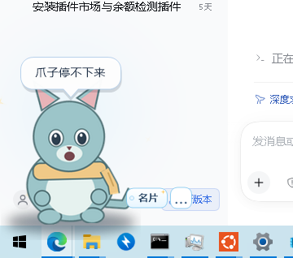
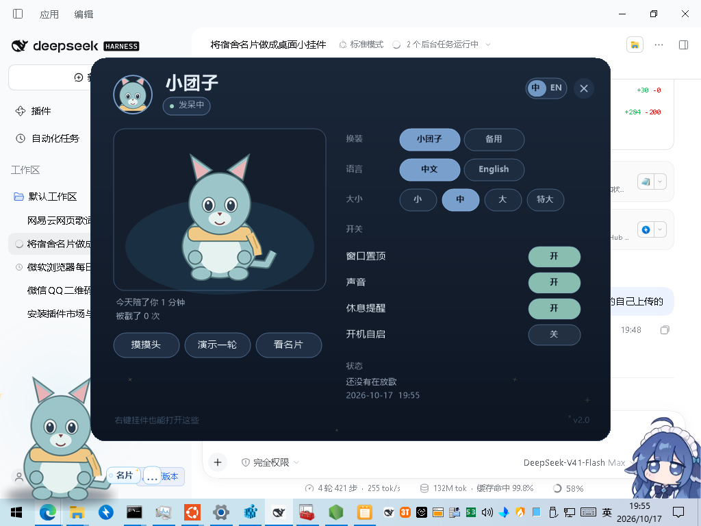
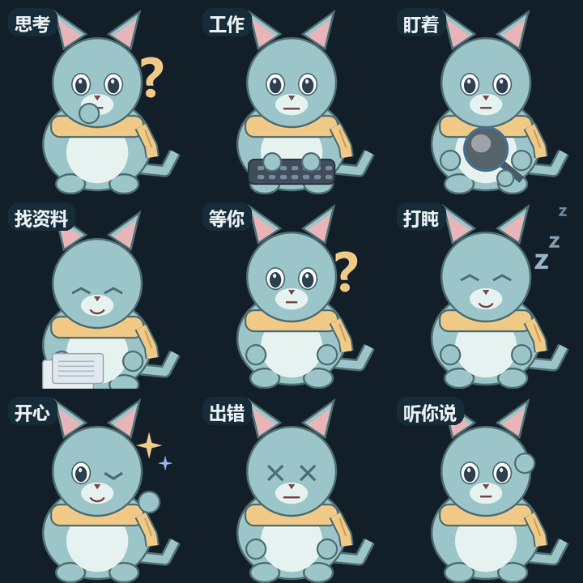
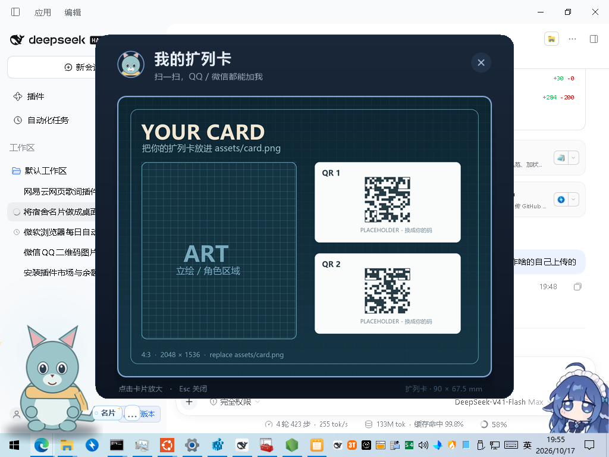

# 桌面挂件素材模板（FurryPet Template）

一个可以直接拿去改成「你自己的桌面宠物」的 Windows 模板：

- 代码、状态机、53 帧动画、控制面板、名片面板、托盘、热键、音乐联动都在；
- 仓库里的角色图是**占位用的「小团子」**，没有任何第三方角色素材；
- 你把 `assets/umi/` 换成自己的 240×240 动作帧、`assets/card.png` 换成自己的名片，
  重新编译一次，它就是你自己的桌面挂件。



> 占位角色是脚本生成的（可自由替换 / 商用）；换上去的图，版权归你。

## 先看效果

| 控制面板 | 全部状态 |
| --- | --- |
|  |  |



## 你只需要换这几样

| 位置 | 规格 | 用途 |
| --- | --- | --- |
| `assets/umi/*.png` | 240×240 透明 PNG，按帧名 | 主角色动作帧（53 张） |
| `assets/umi/face.png` / `face.ico` | 128×128 头像 / 多尺寸 ICO | 控制面板、托盘 |
| `assets/blue/pet.png` | 约 640×600 透明 PNG | 备用皮肤（可留可删） |
| `assets/blue/face.png` / `face.ico` | 同上 | 备用皮肤的头像 |
| `assets/card.png` | 4:3，建议 2048×1536 | 名片 / 扩列卡 |
| `assets/phrases.zh.json` / `.en.json` | JSON | 角色台词 |
| `src/Core.cs` 的 `Loc` | 文本 | 角色名、皮肤名、界面文字 |

完整的帧名、时间轴、画布基线、头像/名片规格见 **[docs/ASSETS.md](docs/ASSETS.md)**。

## 快速开始

1. 先跑占位版：双击 `启动.cmd` 或 `FurryPet.exe`（未签名，可能提示未知发布者，点「运行」）。
2. 换了自己的帧后，重新编译：
   ```powershell
   powershell -ExecutionPolicy Bypass -File .\build.ps1
   ```
3. 想开机自启：右键挂件 →「开机自启」，或运行 `安装开机自启.ps1 install`。
4. 想要桌面快捷方式：右键 `FurryPet.exe` → 发送到 → 桌面快捷方式。

## 文件结构

```
furry-pet-template/
├─ FurryPet.exe              # 构建产物（.gitignore 忽略）
├─ src/
│  ├─ Core.cs                # 入口、Win32、主题、Loc、Phrases、Config、音乐、音效
│  ├─ Pet.cs                 # 分层窗口、状态机、动画、气泡、菜单、托盘
│  └─ Panels.cs              # 控制面板、名片面板、放大窗
├─ assets/
│  ├─ umi/                   # ★ 主角色帧（占位）——换成你的 53 张
│  ├─ blue/                  # ★ 备用皮肤（占位）
│  ├─ card.png               # ★ 名片（占位）
│  ├─ frames.manifest.json   # 帧清单，给画师/脚本看的
│  ├─ phrases.zh.json        # ★ 中文台词
│  ├─ phrases.en.json        # ★ 英文台词
│  └─ sounds/                # boop.wav / ding.wav
├─ docs/
│  ├─ ASSETS.md              # 素材制作指南（最重要的文档）
│  └─ DEVELOPMENT.md         # 代码/状态机扩展
├─ shots/                    # README 截图
├─ .github/workflows/build.yml
├─ 启动.cmd
├─ 安装开机自启.ps1
├─ build.ps1
├─ CHANGELOG.md
├─ LICENSE                   # 代码 MIT
├─ NOTICE                    # 占位素材说明
└─ README.md
```

## 状态与动作

| 状态 | 帧 | 说明 |
| --- | --- | --- |
| 发呆 | `idle-open` / `idle-blink` / `idle-wink` | 13 秒循环，两次眨眼 + 一次 wink |
| 思考 | `think` / `think-blink` | 3.1 秒循环 |
| 工作 | `work` / `work-blink` | 1 秒循环 |
| 盯着 | `watch-*` 8 个方向帧 | 每 0.42 秒一帧 |
| 找资料 | `search` + `search-video-000…023` | 24 帧循环，70ms/帧 |
| 等你 | `wait` / `wait-blink` | 75 秒没输入进入 |
| 打盹 | `rest` | 180 秒没输入进入 |
| 开心 | `happy` / `happy-blink` | 戳一下 / 被唤醒 |
| 出错 | `error` | 演示 / 错误 |
| 听你说 | `listen` / `listen-blink` | 鼠标悬停 |
| 说话 | `talk-closed` / `small` / `medium` / `wide` / `blink` | 气泡出现时 1.5 秒口型循环 |

## 加动作 / 加皮肤 / 加语言

看 [docs/DEVELOPMENT.md](docs/DEVELOPMENT.md)。状态机、`FrameFor`、`Schedule`、
面板命中区、`Loc` 都有说明。

## 构建

只需要 Windows 自带的 .NET Framework 4.x：

```powershell
powershell -ExecutionPolicy Bypass -File .\build.ps1
```

手动：

```powershell
& "$env:WINDIR\Microsoft.NET\Framework64\v4.0.30319\csc.exe" /nologo /target:winexe /platform:anycpu /optimize+ /codepage:65001 `
  /win32icon:"assets\umi\face.ico" /out:"FurryPet.exe" `
  /reference:System.dll /reference:System.Drawing.dll /reference:System.Windows.Forms.dll `
  /reference:System.Web.Extensions.dll /reference:System.Core.dll /reference:Microsoft.CSharp.dll `
  src\Core.cs src\Pet.cs src\Panels.cs
```

## 上传到 GitHub

这个目录就是仓库根目录，`.gitignore` 会忽略 `FurryPet.exe`、`data/`、`logs/`、`dist/`、`*.zip`。

```powershell
cd furry-pet-template
git init
git add .
git commit -m "FurryPet template"
git branch -M main
git remote add origin https://github.com/<你的用户名>/<仓库名>.git
git push -u origin main
```

推上去后 `.github/workflows/build.yml` 会自动编译，Actions 页面可以下载 `FurryPet-win64.zip`。

## 许可

- **代码**：MIT，见 [LICENSE](LICENSE)。
- **占位素材**（`assets/umi/*`、`assets/blue/*`、`assets/card.png`）：由模板作者生成，
  可视为 CC0 / 公共领域，随便替换、修改、商用。
- **你换上去的素材**：版权归你，建议在 README 或 NOTICE 里写清楚。

## 致谢

- 状态与交互设计参考了 [pi-furry-partner](https://github.com/KouzakiUmi/pi-furry-partner)
  （只参考了「会等你、会打盹、会戳一下」的陪伴方式，**没有使用**它的角色图或台词）。
- 桌面歌词条：可选的音乐状态来源。
